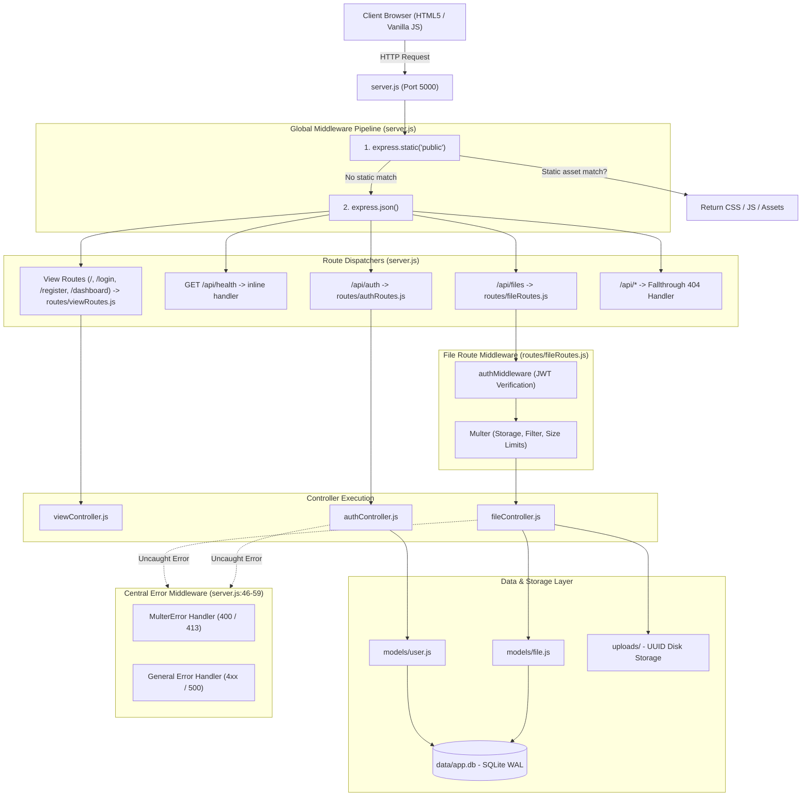
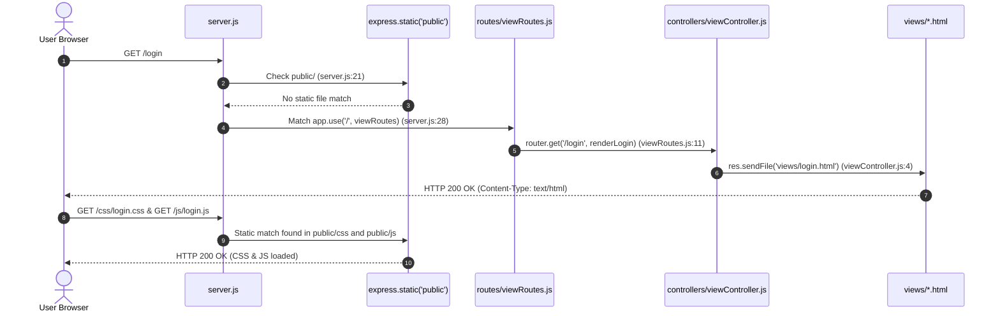
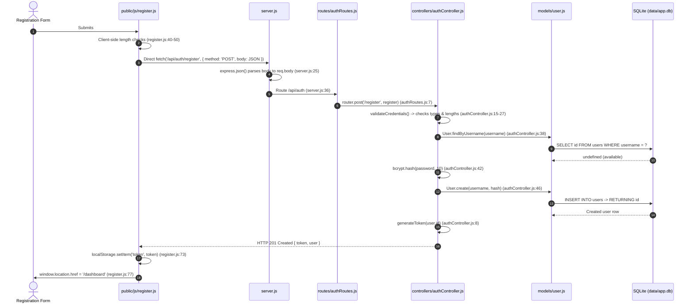
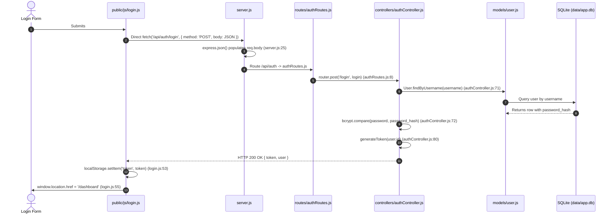
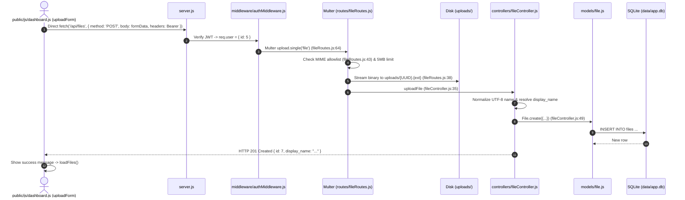
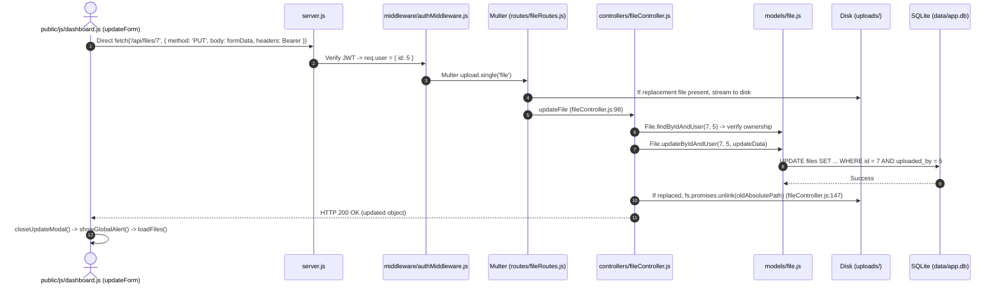
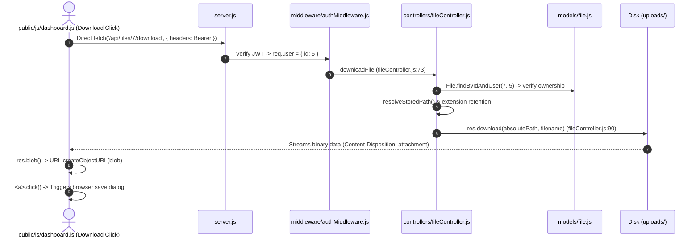
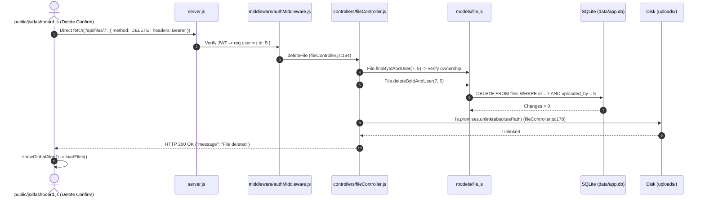

# Complete Request-to-Response Architectural Pathway Guide (Multi-Page MVC)

This document traces the complete end-to-end execution lifecycle for **every view route and API endpoint** in the File Manager application. It details every file, function, line of code (LOC), middleware check, database operation, disk interaction, and client-side DOM mutation for both **Success (OK)** and **Error** execution paths under the multi-page architecture.

---

## Global System Architecture & Middleware Pipeline



---

## Index of Route & API Pathways

1. [`GET /` & Dedicated View Routes (`/login`, `/register`, `/dashboard`)](#1-view-routes--page-delivery)
2. [`GET /api/health` - API Health Check](#2-get-apihealth---api-health-check)
3. [`POST /api/auth/register` - User Registration (Direct `fetch` in `register.js`)](#3-post-apiauthregister---user-registration)
4. [`POST /api/auth/login` - User Login (Direct `fetch` in `login.js`)](#4-post-apiauthlogin---user-login--jwt-generation)
5. [`GET /api/files` - List Files (Direct `fetch` in `dashboard.js`)](#5-get-apifiles---list-authenticated-users-files)
6. [`POST /api/files` - Upload File (Direct `fetch` in `dashboard.js`)](#6-post-apifiles---upload-file-with-custom-display-name)
7. [`PUT /api/files/:id` - Update File (Direct `fetch` in `dashboard.js`)](#7-put-apifilesid---update-file-rename-or-replace-physical-file)
8. [`GET /api/files/:id/download` - Stream Download (Direct `fetch` in `dashboard.js`)](#8-get-apifilesiddownload---stream-authenticated-file-download)
9. [`DELETE /api/files/:id` - Delete File (Direct `fetch` in `dashboard.js`)](#9-delete-apifilesid---delete-file-database--disk-cleanup)
10. [`Fallthrough & Global Error Handlers` - 404 & Central Error Middleware](#10-fallthrough--global-error-handlers)

---

## 1. View Routes & Page Delivery

### 1.1 Specification
* **Root Route:** `GET /` -> Redirects (HTTP 302) to `/login`.
* **Login Page:** `GET /login` -> Serves `views/login.html` (paired with `login.css` and `login.js`).
* **Register Page:** `GET /register` -> Serves `views/register.html` (paired with `register.css` and `register.js`).
* **Dashboard Page:** `GET /dashboard` -> Serves `views/dashboard.html` (paired with `dashboard.css` and `dashboard.js`).

---

### 1.2 Pathway Diagram



---

### 1.3 Execution Details
1. **Root Redirect (`routes/viewRoutes.js:10`):**
   ```javascript
   router.get('/', (req, res) => res.redirect('/login'));
   ```
2. **Page Delivery (`controllers/viewController.js:3-13`):**
   * Calls `res.sendFile(path.join(__dirname, '..', 'views', '<page>.html'))`.
   * Sets `Content-Type: text/html; charset=UTF-8`.
3. **Asset Delivery (`server.js:21`):**
   * Serves dedicated stylesheets (`public/css/login.css`, `public/css/register.css`, `public/css/dashboard.css`).
   * Serves dedicated scripts (`public/js/login.js`, `public/js/register.js`, `public/js/dashboard.js`).

---

## 2. `GET /api/health` - API Health Check

### 2.1 Specification
* **Purpose:** Instant server health probe.
* **Authentication:** None.
* **Request:** `GET http://localhost:5000/api/health`
* **Response:** HTTP `200 OK` `{"status": "ok"}` (`server.js:31-33`).

---

## 3. `POST /api/auth/register` - User Registration

### 3.1 Specification
* **Purpose:** Creates a user, hashes their password with bcrypt, and issues a JWT.
* **Initiator:** Direct `fetch()` call in [public/js/register.js](file:///c:/Users/ASUS/OneDrive/Desktop/file_manager%20-%20Copy/public/js/register.js).
* **Endpoint:** `POST /api/auth/register`
* **Body:** `{"username": "...", "password": "..."}`

---

### 3.2 Pathway Diagram



---

### 3.3 Error Branches & Handlers

| Trigger / Condition | Line of Origin | HTTP Status | Response JSON | Frontend Effect in `register.js` |
|---|---|---|---|---|
| Username < 3 chars or > 30 chars | `register.js:40` & `authController.js:19` | `400` | `{"message": "Username must be 3-30 characters"}` | Displays in `#register-error` |
| Password < 6 chars or > 72 chars | `register.js:46` & `authController.js:22` | `400` | `{"message": "Password must be 6-72 characters"}` | Displays in `#register-error` |
| Username already taken | `authController.js:39` | `409` | `{"message": "Username already taken"}` | Displays in `#register-error` |
| SQLite UNIQUE race collision | `authController.js:51` | `409` | `{"message": "Username already taken"}` | Displays in `#register-error` |
| Server / DB error | `server.js:58` | `500` | `{"message": "Server error"}` | Displays in `#register-error` |

---

## 4. `POST /api/auth/login` - User Login & JWT Generation

### 4.1 Specification
* **Purpose:** Authenticates user credentials and issues a signed JWT token.
* **Initiator:** Direct `fetch()` call in [public/js/login.js](file:///c:/Users/ASUS/OneDrive/Desktop/file_manager%20-%20Copy/public/js/login.js).
* **Endpoint:** `POST /api/auth/login`
* **Body:** `{"username": "...", "password": "..."}`

---

### 4.2 Pathway Diagram



---

### 4.3 Error Branches & Handlers

| Condition | Line of Origin | HTTP Status | Response JSON | Frontend Effect in `login.js` |
|---|---|---|---|---|
| Missing username or password | `authController.js:68` | `400` | `{"message": "Username and password are required"}` | Displays in `#login-error` |
| Non-existent user OR wrong password | `authController.js:77` | `401` | `{"message": "Invalid username or password"}` | Displays in `#login-error` |
| Server exception | `server.js:58` | `500` | `{"message": "Server error"}` | Displays in `#login-error` |

---

## 5. `GET /api/files` - List Authenticated User's Files

### 5.1 Specification
* **Purpose:** Fetches all files owned by the logged-in user.
* **Initiator:** Direct `fetch()` call in [public/js/dashboard.js](file:///c:/Users/ASUS/OneDrive/Desktop/file_manager%20-%20Copy/public/js/dashboard.js) (`loadFiles()`).
* **Endpoint:** `GET /api/files`
* **Header:** `Authorization: Bearer <token>`

---

### 5.2 Pathway Diagram

```mermaid
sequenceDiagram
    autonumber
    actor DashJS as public/js/dashboard.js (loadFiles)
    participant Server as server.js
    participant AuthMW as middleware/authMiddleware.js
    participant FileRoute as routes/fileRoutes.js
    participant FileCtrl as controllers/fileController.js
    participant Model as models/file.js
    participant DB as SQLite (data/app.db)

    DashJS->>Server: Direct fetch('/api/files', { headers: { Authorization: Bearer token } })
    Server->>FileRoute: Route /api/files (server.js:37)
    FileRoute->>AuthMW: router.use(authMiddleware) (fileRoutes.js:62)
    AuthMW->>AuthMW: jwt.verify(token, JWT_SECRET, {algorithms: ['HS256']})
    AuthMW->>FileRoute: req.user = { id: 5 }; next() (authMiddleware.js:23)
    FileRoute->>FileCtrl: router.get('/', listFiles) (fileRoutes.js:65)
    FileCtrl->>Model: File.findByUser(req.user.id) (fileController.js:68)
    Model->>DB: SELECT * FROM files WHERE uploaded_by = 5
    DB-->>Model: Rows matching owner
    FileCtrl->>FileCtrl: toPublic(file) mapping (fileController.js:12-19)
    FileCtrl-->>DashJS: HTTP 200 OK [ { id, display_name, original_name, ... } ]
    DashJS->>DashJS: renderTable(files) -> Populates tbody#file-table-body
```

---

### 5.3 Error Branches & Handlers

| Condition | Line of Origin | HTTP Status | Response JSON | Frontend Effect in `dashboard.js` |
|---|---|---|---|---|
| Missing token / unauthenticated | `authMiddleware.js:10` | `401` | `{"message": "Authentication required"}` | `handleUnauthorized()` -> redirect to `/login` |
| Expired JWT token | `authMiddleware.js:26` | `401` | `{"message": "Token expired, please log in again"}` | `handleUnauthorized()` -> redirect to `/login` |
| Database error | `server.js:58` | `500` | `{"message": "Server error"}` | Displays in `#file-list-error` |

---

## 6. `POST /api/files` - Upload File with Custom Display Name

### 6.1 Specification
* **Purpose:** Uploads a physical file to disk, assigns an optional custom display name, and records metadata in SQLite.
* **Initiator:** Direct `fetch()` call in [public/js/dashboard.js](file:///c:/Users/ASUS/OneDrive/Desktop/file_manager%20-%20Copy/public/js/dashboard.js) (`#upload-form` submit).
* **Endpoint:** `POST /api/files`
* **Header:** `Authorization: Bearer <token>`
* **Content-Type:** `multipart/form-data` (`file`, optional `display_name`)

---

### 6.2 Pathway Diagram



---

### 6.3 Error Branches & Handlers

| Condition | Line of Origin | HTTP Status | Response JSON | Frontend Effect in `dashboard.js` |
|---|---|---|---|---|
| MIME type not allowed | `fileRoutes.js:46` | `400` | `{"message": "File type not allowed"}` | Displays in `#upload-message` |
| File > 5 MB | `server.js:50` | `413` | `{"message": "File is too large"}` | Displays in `#upload-message` |
| Missing file in request | `fileController.js:37` | `400` | `{"message": "No file uploaded..."}` | Displays in `#upload-message` |
| Expired / invalid JWT | `authMiddleware.js:27` | `401` | `{"message": "Token expired..."}` | `handleUnauthorized()` -> redirect to `/login` |
| SQLite insert failure | `fileController.js:61` | `500` | `{"message": "Server error"}` | Disk file unlinked, shows error |

---

## 7. `PUT /api/files/:id` - Update File (Rename or Replace Physical File)

### 7.1 Specification
* **Purpose:** Updates file display name and/or replaces physical file on disk.
* **Initiator:** Direct `fetch()` call in [public/js/dashboard.js](file:///c:/Users/ASUS/OneDrive/Desktop/file_manager%20-%20Copy/public/js/dashboard.js) (`#update-form` submit).
* **Endpoint:** `PUT /api/files/:id`
* **Header:** `Authorization: Bearer <token>`
* **Content-Type:** `multipart/form-data` (optional `display_name`, optional `file`)

---

### 7.2 Pathway Diagram



---

### 7.3 Error Branches & Handlers

| Condition | Line of Origin | HTTP Status | Response JSON | Frontend Effect in `dashboard.js` |
|---|---|---|---|---|
| File belongs to someone else | `fileController.js:105` | `404` | `{"message": "File not found"}` | Replacement file unlinked, shows 404 |
| Neither name nor file provided | `fileController.js:135` | `400` | `{"message": "No update data provided..."}` | Displays in `#update-message` |
| Replacement file violates MIME | `fileRoutes.js:46` | `400` | `{"message": "File type not allowed"}` | Displays in `#update-message` |
| Replacement file > 5 MB | `server.js:50` | `413` | `{"message": "File is too large"}` | Displays in `#update-message` |
| Expired JWT | `authMiddleware.js:27` | `401` | `{"message": "Token expired..."}` | Redirects to `/login` |

---

## 8. `GET /api/files/:id/download` - Stream Authenticated File Download

### 8.1 Specification
* **Purpose:** Streams binary file bytes to the client using JWT Bearer authentication.
* **Initiator:** Direct `fetch()` call in [public/js/dashboard.js](file:///c:/Users/ASUS/OneDrive/Desktop/file_manager%20-%20Copy/public/js/dashboard.js) (Download button click).
* **Endpoint:** `GET /api/files/:id/download`
* **Header:** `Authorization: Bearer <token>`

---

### 8.2 Pathway Diagram



---

### 8.3 Error Branches & Handlers

| Condition | Line of Origin | HTTP Status | Response JSON | Frontend Effect in `dashboard.js` |
|---|---|---|---|---|
| Unauthenticated / missing token | `authMiddleware.js:10` | `401` | `{"message": "Authentication required"}` | `handleUnauthorized()` -> redirect to `/login` |
| File ID belongs to another user | `fileController.js:76` | `404` | `{"message": "File not found"}` | Shows global alert banner |
| File missing on disk | `fileController.js:80` | `404` | `{"message": "File is missing on the server"}` | Shows global alert banner |
| Socket error during stream | `fileController.js:92` | `500` | `{"message": "Could not send file"}` | Shows global alert banner |

---

## 9. `DELETE /api/files/:id` - Delete File (Database & Disk Cleanup)

### 9.1 Specification
* **Purpose:** Permanently deletes a file record from SQLite and unlinks the physical file from disk.
* **Initiator:** Direct `fetch()` call in [public/js/dashboard.js](file:///c:/Users/ASUS/OneDrive/Desktop/file_manager%20-%20Copy/public/js/dashboard.js) (`executeDelete()`).
* **Endpoint:** `DELETE /api/files/:id`
* **Header:** `Authorization: Bearer <token>`

---

### 9.2 Pathway Diagram



---

### 9.3 Error Branches & Handlers

| Condition | Line of Origin | HTTP Status | Response JSON | Frontend Effect in `dashboard.js` |
|---|---|---|---|---|
| Unauthenticated / missing token | `authMiddleware.js:10` | `401` | `{"message": "Authentication required"}` | `handleUnauthorized()` -> redirect to `/login` |
| File ID belongs to another user | `fileController.js:167` | `404` | `{"message": "File not found"}` | Shows delete failed alert |
| File ID does not exist | `fileController.js:167` | `404` | `{"message": "File not found"}` | Shows delete failed alert |
| Database error | `server.js:58` | `500` | `{"message": "Server error"}` | Shows delete failed alert |

---

## 10. Fallthrough & Global Error Handlers

### 10.1 Unknown API Route Fallthrough Handler
```javascript
// server.js:40-42
app.use('/api', (req, res) => {
  res.status(404).json({ message: 'Route not found' });
});
```
* **Trigger:** Any HTTP method requested under `/api/*` that does not match any registered endpoint.
* **Response:** HTTP `404 Not Found` `{"message": "Route not found"}`.

### 10.2 Central Express Error Middleware
```javascript
// server.js:46-59
app.use((err, req, res, next) => {
  if (err instanceof multer.MulterError) {
    const tooLarge = err.code === 'LIMIT_FILE_SIZE';
    return res
      .status(tooLarge ? 413 : 400)
      .json({ message: tooLarge ? 'File is too large' : `Upload error: ${err.message}` });
  }

  const status = err.status || 500;
  if (status >= 500) console.error(err);
  res.status(status).json({ message: status >= 500 ? 'Server error' : err.message });
});
```
* **Multer File Size Violation:** Returns HTTP `413 Payload Too Large` `{"message": "File is too large"}`.
* **Multer Generic Error:** Returns HTTP `400 Bad Request` `{"message": "Upload error: ..."}`.
* **Unhandled Server Exceptions:** Masks raw server stack traces from the client and returns HTTP `500` `{"message": "Server error"}` while logging details to the terminal console.
