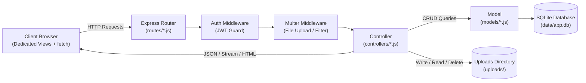
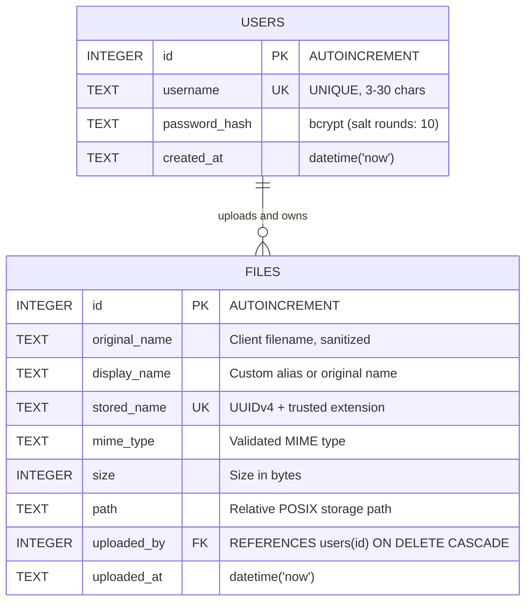

# Comprehensive Technical Learning and Documentation Guide: Personal File Manager

**Architecture:** Dedicated Multi-Page Model-View-Controller (MVC)  
**Technology Stack:** Node.js, Express 5, SQLite (`better-sqlite3`), Vanilla HTML5/CSS3/ES6 JavaScript, JWT (`jsonwebtoken`), `bcryptjs`, `multer`  
**Storage Model:** Relational SQLite Database + Cryptographically Sandboxed Local File Storage  

---

## Table of Contents
1. [CHAPTER 1: Executive Summary & System Overview](#chapter-1-executive-summary--system-overview)
   - 1.1 Project Mission & Problem Statement
   - 1.2 Core Architectural Principles
   - 1.3 Architectural Evolution: From Single-Page SPA to Clean Multi-Page MVC
2. [CHAPTER 2: Directory Structure & File Map](#chapter-2-directory-structure--file-map)
3. [CHAPTER 3: Database Schema & Storage Architecture](#chapter-3-database-schema--storage-architecture)
   - 3.1 SQLite Engine Configuration (WAL Mode & Foreign Keys)
   - 3.2 Entity-Relationship (ER) Model
   - 3.3 Data Dictionary
4. [CHAPTER 4: In-Depth Component Breakdown](#chapter-4-in-depth-component-breakdown)
   - 4.1 Server Orchestration (`server.js`)
   - 4.2 Database Initialization & Schema (`config/db.js`)
   - 4.3 Data Layer / Models (`models/user.js`, `models/file.js`)
   - 4.4 Security & Middleware (`middleware/authMiddleware.js`)
   - 4.5 Controller Logic (`controllers/authController.js`, `controllers/fileController.js`, `controllers/viewController.js`)
   - 4.6 Routing & Multer Configuration (`routes/fileRoutes.js`, `routes/authRoutes.js`, `routes/viewRoutes.js`)
   - 4.7 Frontend Architecture & Scripts (`public/js/login.js`, `public/js/register.js`, `public/js/dashboard.js`)
5. [CHAPTER 5: REST API Specification](#chapter-5-rest-api-specification)
6. [CHAPTER 6: Security Architecture & Threat Defense](#chapter-6-security-architecture--threat-defense)
7. [CHAPTER 7: Setup, Environment & Deployment Guide](#chapter-7-setup-environment--deployment-guide)
8. [CHAPTER 8: Viva & Technical Interview Guide](#chapter-8-viva--technical-interview-guide)

---

## CHAPTER 1: Executive Summary & System Overview

### 1.1 Project Mission & Problem Statement
The **Personal File Manager** is a multi-tenant cloud storage platform engineered to provide secure user registration, token-authenticated sessions, and complete lifecycle management for personal files (documents, images, spreadsheets, and archives). 

Modern applications frequently suffer from bloated client bundles, brittle client-side routing, and security flaws like Broken Object-Level Authorization (IDOR) and arbitrary file upload vulnerabilities. This project solves these challenges through:
- **Strict Data Isolation:** Users can strictly interact only with their own files. Database queries enforce ownership at the SQL statement level.
- **Defensive File Handling:** Uploaded files are stripped of client-supplied names, stored under cryptographically random UUIDs, restricted to trusted MIME extensions, and guarded against path traversal.
- **Zero-Dependency Frontend:** Dedicated, fast HTML5/CSS3/JavaScript pages utilizing native browser `fetch()` APIs without heavy front-end frameworks (React, Vue) or build tooling (Vite, Webpack).

---

### 1.2 Core Architectural Principles

#### 1. Pure Model-View-Controller (MVC) Pattern
* **Model (`models/`):** Encapsulates direct database interaction via prepared SQLite statements. Models hold zero knowledge of HTTP headers, request bodies, or browser rendering.
* **View (`views/` & `public/`):** Dedicated semantic HTML5 documents, CSS stylesheets, and client-side JavaScript controllers for `/login`, `/register`, and `/dashboard`.
* **Controller (`controllers/`):** Orchestrates application flow, validates input parameters, delegates tasks to Models and storage APIs, and formats HTTP responses.



---

### 1.3 Architectural Evolution: From Single-Page SPA to Clean Multi-Page MVC

1. **Phase 1: React + Vite Single-Page Application (SPA)**
   - *Architecture:* Dual-server architecture (Node.js API on port 5000 + Vite development server on port 5173).
   - *Drawbacks:* Over 300 MB of dependencies in `node_modules`, complex JSX transpilation, state synchronization issues across page transitions, and proxy configuration overhead.
2. **Phase 2: Monolithic Single-Page Vanilla App**
   - *Architecture:* Single HTML page (`index.html`) toggling hidden views using a central JavaScript wrapper (`api.js`).
   - *Drawbacks:* Brittle state machines, compromised browser history navigation (back/forward buttons did not work properly), and an unnecessarily deep call stack.
3. **Phase 3: Multi-Page Dedicated MVC (Current Production Standard)**
   - *Architecture:* Independent pages for `/login`, `/register`, and `/dashboard`, each served directly by Express with its own dedicated stylesheet and script.
   - *Elimination of `api.js`:* Every page script directly dispatches native browser `fetch()` requests. No artificial wrapper layers.
   - *Results:* Instant page loading, native browser history and deep linking, isolated error domains, and high code maintainability.

---

## CHAPTER 2: Directory Structure & File Map

```text
File_Manager/
├── config/
│   └── db.js                        # SQLite connection, WAL journal mode & schema migration
├── controllers/                     # Application business logic & coordination
│   ├── authController.js            # User registration & password/JWT verification
│   ├── fileController.js            # File upload, retrieval, replacement, stream & deletion
│   └── viewController.js            # Static view delivery (renderLogin, renderRegister, renderDashboard)
├── data/                            # Persistent database storage
│   └── app.db                       # Active SQLite relational database file
├── middleware/                      # HTTP request interception & authentication
│   └── authMiddleware.js            # JWT Bearer token authentication guard
├── models/                          # Database data access objects (Prepared SQL queries)
│   ├── file.js                      # File metadata queries with strict ownership isolation
│   └── user.js                      # User account queries & uniqueness constraints
├── public/                          # Public static web assets served by Express
│   ├── css/                         # Dedicated stylesheets per view
│   │   ├── dashboard.css            # Repository styling, modals & table layout
│   │   ├── login.css                # Authentication form aesthetics & card styling
│   │   └── register.css             # Registration layout & validation styling
│   └── js/                          # Client-side JavaScript controllers (Direct fetch)
│       ├── dashboard.js             # Table rendering, file upload, update modal, delete & download
│       ├── login.js                 # Login credential submission & session persistence
│       └── register.js              # Registration submission & input verification
├── routes/                          # Express endpoint route definitions
│   ├── authRoutes.js                # Endpoints: /api/auth/register, /api/auth/login
│   ├── fileRoutes.js                # Endpoints: /api/files (Multer disk storage & filters)
│   └── viewRoutes.js                # Frontend page routes: /, /login, /register, /dashboard
├── uploads/                         # Cryptographically secured file storage (UUID.ext)
│   └── .gitkeep                     # Keeps folder present in git while ignoring stored files
├── views/                           # Dedicated HTML5 semantic templates
│   ├── dashboard.html               # Multi-action authenticated workspace view
│   ├── login.html                   # Login portal template
│   └── register.html                # Account creation portal template
├── .env                             # Environment variables & secrets (Ignored in Git)
├── .env.example                     # Environment template for team onboarding
├── .gitignore                       # Git exclusions (node_modules, .env, data/, uploads/*)
├── API_REQUEST_RESPONSE_PATHWAYS.md # Detailed sequence diagrams and error matrix
├── DOCUMENTATION.md                 # Technical learning and system architectural manual
├── package.json                     # Project manifest, scripts & dependencies
├── package-lock.json                # Pinned dependency lockfile
├── README.md                        # Quickstart and overview documentation
└── server.js                        # Application entry point & centralized error pipeline
```

---

## CHAPTER 3: Database Schema & Storage Architecture

### 3.1 SQLite Engine Configuration (WAL Mode & Foreign Keys)
The application uses SQLite via the synchronous, C++ backed `better-sqlite3` driver. Two critical database PRAGMAs are initialized upon boot in [config/db.js](file:///C:/Users/ASUS/OneDrive/Desktop/File_Manager/config/db.js):
1. `PRAGMA foreign_keys = ON;`
   - *Rationale:* SQLite disables foreign keys by default. Enabling this ensures relational integrity between `files.uploaded_by` and `users.id`, triggering cascade deletes when a user account is removed.
2. `PRAGMA journal_mode = WAL;`
   - *Rationale:* Write-Ahead Logging (WAL) enables concurrent readers and writers without lock contention, dramatically improving throughput in multi-request environments.

---

### 3.2 Entity-Relationship (ER) Model



---

### 3.3 Data Dictionary

#### Table: `users`
| Column | Type | Constraints | Description |
|---|---|---|---|
| `id` | `INTEGER` | `PRIMARY KEY AUTOINCREMENT` | Unique identifier for each user |
| `username` | `TEXT` | `NOT NULL UNIQUE` | Unique handle (sanitized, 3-30 characters) |
| `password_hash` | `TEXT` | `NOT NULL` | One-way hash generated with bcryptjs (10 rounds) |
| `created_at` | `TEXT` | `NOT NULL DEFAULT (datetime('now'))` | Account registration timestamp (UTC) |

#### Table: `files`
| Column | Type | Constraints | Description |
|---|---|---|---|
| `id` | `INTEGER` | `PRIMARY KEY AUTOINCREMENT` | Unique file tracking identifier |
| `original_name` | `TEXT` | `NOT NULL` | Original client-side filename with Latin-1/UTF-8 fix |
| `display_name` | `TEXT` | `NULLABLE` | User-defined display label for UI representation |
| `stored_name` | `TEXT` | `NOT NULL UNIQUE` | Cryptographic random filename (`{UUID}.{ext}`) |
| `mime_type` | `TEXT` | `NOT NULL` | Server-validated MIME type |
| `size` | `INTEGER` | `NOT NULL` | Binary file payload size in bytes |
| `path` | `TEXT` | `NOT NULL` | Storage path relative to project root (`uploads/{UUID}.{ext}`) |
| `uploaded_by` | `INTEGER` | `NOT NULL REFERENCES users(id) ON DELETE CASCADE` | User ID of owner. Indexed via `idx_files_uploaded_by` |
| `uploaded_at` | `TEXT` | `NOT NULL DEFAULT (datetime('now'))` | Timestamp of upload or latest update |

---

## CHAPTER 4: In-Depth Component Breakdown

### 4.1 Server Orchestration (`server.js`)
The root file [server.js](file:///C:/Users/ASUS/OneDrive/Desktop/File_Manager/server.js) initializes the Express instance, mounts top-level middleware, registers routes, and houses the global 4-parameter error handler:

1. **Static Middleware:** `app.use(express.static(path.join(__dirname, 'public')))` exposes stylesheets, client scripts, and images.
2. **JSON Parsing:** `app.use(express.json())` parses incoming `application/json` bodies for authentication routes.
3. **Route Mounting:** Mounts `viewRoutes` at `/`, `authRoutes` at `/api/auth`, and `fileRoutes` at `/api/files`.
4. **Centralized Error Middleware:**
   ```javascript
   app.use((err, req, res, next) => {
     if (err instanceof multer.MulterError) {
       const tooLarge = err.code === 'LIMIT_FILE_SIZE';
       return res
         .status(tooLarge ? 413 : 400)
         .json({ message: tooLarge ? 'File is too large' : `Upload error: ${err.message}` });
     }
     const status = err.status || 500;
     if (status >= 500) console.error(err);
     res.status(status).json({ message: status >= 500 ? 'Server error' : err.message });
   });
   ```
   *Captures Multer size violations (`413 Payload Too Large`), general upload errors (`400 Bad Request`), and prevents sensitive server stack traces from leaking to clients on internal errors (`500 Server error`).*

---

### 4.2 Database Initialization & Schema (`config/db.js`)
[config/db.js](file:///C:/Users/ASUS/OneDrive/Desktop/File_Manager/config/db.js) ensures that the target database directory exists and creates all required tables and indexes upon module load:
- **Automatic Migration:** Checks `PRAGMA table_info(files)` and automatically runs `ALTER TABLE files ADD COLUMN display_name TEXT;` if the database was created under an older schema version.
- **Index Optimization:** Runs `CREATE INDEX IF NOT EXISTS idx_files_uploaded_by ON files(uploaded_by);` to guarantee $O(\log N)$ lookup performance when retrieving a user's file repository.

---

### 4.3 Data Layer / Models

#### 1. `models/user.js`
- **Prepared Statements:** Compiles SQL queries at module load time (`db.prepare(...)`).
- **Security Rule:** Two distinct select statements:
  - `selectByUsername`: Retrieves `password_hash` strictly for internal verification in `authController.js`.
  - `selectById`: Omits `password_hash` entirely to eliminate accidental serialization to the frontend.

#### 2. `models/file.js`
- **Enforced Tenant Isolation:** Every data access query (`selectByUser`, `selectByIdAndUser`, `deleteByIdAndUser`, `updateFileQuery`) incorporates `AND uploaded_by = ?` in its `WHERE` clause.
- **Dynamic Partial Updates (`COALESCE`):**
  ```sql
  UPDATE files
  SET original_name = COALESCE(@original_name, original_name),
      display_name  = COALESCE(@display_name, display_name),
      stored_name   = COALESCE(@stored_name, stored_name),
      mime_type     = COALESCE(@mime_type, mime_type),
      size          = COALESCE(@size, size),
      path          = COALESCE(@path, path),
      uploaded_at   = datetime('now')
  WHERE id = @id AND uploaded_by = @uploaded_by
  ```
  *Allows updating just the file label, just the binary payload, or both simultaneously without wiping existing column values.*

---

### 4.4 Security & Middleware (`middleware/authMiddleware.js`)
Intercepts incoming HTTP requests to protect file management endpoints:
1. **Header Parsing:** Checks for `Authorization: Bearer <token>`. Returns `401 Unauthorized` if missing or malformed.
2. **Algorithm Pinning:** Verifies tokens using `jwt.verify(token, secret, { algorithms: ['HS256'] })`. This prevents algorithmic confusion attacks (e.g., attackers modifying the JWT header to `"alg": "none"` or using asymmetric public keys).
3. **Safe Identity Injection:** Decodes `decoded.id` and assigns it to `req.user = { id: decoded.id }`. Downstream controllers access `req.user.id` exclusively from this verified cryptographically signed payload.

---

### 4.5 Controller Logic

#### 1. `controllers/authController.js`
- **Input Sanitization:** Enforces length constraints (usernames 3-30 chars, passwords 6-72 chars). The 72-byte limit matches the maximum password capacity of the bcrypt algorithm.
- **Timing Attack Mitigation:** Returns identical generic error messages (`"Invalid username or password"`) for both non-existent accounts and incorrect passwords to prevent username harvesting.
- **Concurrency Protection:** Wraps `User.create` in a try/catch block to intercept `SQLITE_CONSTRAINT_UNIQUE` collisions if two users register identical handles concurrently.

#### 2. `controllers/fileController.js`
- **File Upload (`uploadFile`):**
  - Fixes multipart filename encoding (`Buffer.from(req.file.originalname, 'latin1').toString('utf8')`) to support international characters and emojis.
  - **Orphan File Prevention:** If the database insert fails, the newly uploaded disk file is cleaned up via `fs.promises.unlink(req.file.path)` inside the catch block.
- **File Listing (`listFiles`):** Returns metadata scrubbed by `toPublic()`, stripping internal server paths and disk filenames.
- **File Download (`downloadFile`):**
  - Resolves path strictly inside the `uploads/` directory via `resolveStoredPath()`.
  - Streams the file with `res.download()`, setting `Content-Disposition` to the user-friendly `display_name`.
- **File Replacement & Rename (`updateFile`):**
  - Allows swapping out the physical binary file while preserving the database ID and download statistics.
  - Safely deletes the old binary from disk only *after* the new database record is successfully committed.
- **File Deletion (`deleteFile`):**
  - Executes a two-phase cleanup: deletes the SQLite row first, then calls `fs.promises.unlink()` on the physical storage file.

#### 3. `controllers/viewController.js`
Delivers dedicated HTML documents (`login.html`, `register.html`, `dashboard.html`) using Express `res.sendFile()` with absolute path resolution.

---

### 4.6 Routing & Multer Configuration (`routes/fileRoutes.js`)
File uploads are handled by `multer` using disk storage configured as follows:
```javascript
const ALLOWED_TYPES = {
  'image/png': '.png',
  'image/jpeg': '.jpg',
  'image/gif': '.gif',
  'image/webp': '.webp',
  'application/pdf': '.pdf',
  'text/plain': '.txt',
  'text/csv': '.csv',
  'application/vnd.openxmlformats-officedocument.wordprocessingml.document': '.docx',
  'application/vnd.openxmlformats-officedocument.spreadsheetml.sheet': '.xlsx',
};

const storage = multer.diskStorage({
  destination: (req, file, cb) => cb(null, UPLOAD_DIR),
  filename: (req, file, cb) => {
    // Random UUID + trusted extension mapping: no name collisions, no path traversal.
    cb(null, crypto.randomUUID() + ALLOWED_TYPES[file.mimetype]);
  },
});
```
- **Authentication Order:** `router.use(authMiddleware)` executes *before* Multer. Unauthenticated requests are rejected immediately with HTTP 401 before Multer consumes disk space or streams binary bytes.
- **Size Limits:** Hard-capped at 5 MB (or `MAX_FILE_SIZE_MB` from `.env`).

---

### 4.7 Frontend Architecture & Scripts (No Frameworks, Direct `fetch()`)

```text
               +-------------------------------------------------------+
               |                  Browser LocalStorage                 |
               |             token: eyJhbGciOi...                      |
               |             user: {"id":1,"username":"alice"}         |
               +-------------------------------------------------------+
                                          |
                   +----------------------+----------------------+
                   |                                             |
                   v                                             v
       [public/js/login.js]                           [public/js/dashboard.js]
  - Submits JSON to /api/auth/login              - Client-side auth guard on load
  - Writes token & user to storage               - Direct fetch('/api/files', Bearer)
  - Redirects -> /dashboard                      - Uploads multipart/form-data
                                                 - In-memory modal updates
                                                 - Streamed Blob URL downloads
```

- **[login.js](file:///C:/Users/ASUS/OneDrive/Desktop/File_Manager/public/js/login.js):** Checks if token exists; if so, immediately redirects to `/dashboard`. Otherwise, submits credentials to `/api/auth/login`, stores the token, and transitions pages.
- **[register.js](file:///C:/Users/ASUS/OneDrive/Desktop/File_Manager/public/js/register.js):** Validates password confirmation match client-side, submits to `/api/auth/register`, saves the returned token, and signs the user in instantly.
- **[dashboard.js](file:///C:/Users/ASUS/OneDrive/Desktop/File_Manager/public/js/dashboard.js):** 
  - Verifies token presence on load. If absent, redirects to `/login`.
  - Attaches `Authorization: Bearer <token>` to all API calls.
  - Automatically intercepts `401 Unauthorized` responses and logs out the user.
  - Implements binary streaming downloads:
    ```javascript
    const blob = await res.blob();
    const blobUrl = URL.createObjectURL(blob);
    const anchor = document.createElement('a');
    anchor.href = blobUrl;
    anchor.download = file.display_name;
    anchor.click();
    URL.revokeObjectURL(blobUrl);
    ```

---

## CHAPTER 5: REST API Specification

### 5.1 Authentication Endpoints

#### 1. Register User
- **Route:** `POST /api/auth/register`
- **Content-Type:** `application/json`
- **Request Body:**
  ```json
  {
    "username": "alice",
    "password": "Password123"
  }
  ```
- **Responses:**
  - `201 Created`: User registered and token returned.
    ```json
    {
      "token": "eyJhbGciOi...",
      "user": { "id": 1, "username": "alice" }
    }
    ```
  - `400 Bad Request`: Validation failure (`"Username must be 3-30 characters"`).
  - `409 Conflict`: `"Username already taken"`.

#### 2. User Login
- **Route:** `POST /api/auth/login`
- **Content-Type:** `application/json`
- **Request Body:**
  ```json
  {
    "username": "alice",
    "password": "Password123"
  }
  ```
- **Responses:**
  - `200 OK`: Valid credentials; returns JWT session pass.
  - `401 Unauthorized`: `"Invalid username or password"`.

---

### 5.2 File Management Endpoints (All require `Authorization: Bearer <token>`)

| Method | Endpoint | Payload Type | Description | Success Code |
|---|---|---|---|---|
| `GET` | `/api/files` | None | Lists all files owned by current user | `200 OK` |
| `POST` | `/api/files` | `multipart/form-data` | Uploads a new file (`file`, optional `name`) | `201 Created` |
| `GET` | `/api/files/:id/download` | None | Streams binary file download | `200 OK` |
| `PUT` | `/api/files/:id` | `multipart/form-data` | Updates display name or replaces file | `200 OK` |
| `DELETE` | `/api/files/:id` | None | Deletes file record and unlinks disk storage | `200 OK` |

---

## CHAPTER 6: Security Architecture & Threat Defense

| Threat / Attack Vector | Vulnerability Description | System Defense Implementation |
|---|---|---|
| **SQL Injection** | Attacker injects raw SQL syntax into user parameters to access or corrupt tables. | **Parameterized Prepared Statements:** All queries in `models/` use SQLite's native `?` and `@parameter` placeholders compiled via `better-sqlite3`. Inputs are never concatenated into SQL strings. |
| **Broken Object-Level Authorization (IDOR)** | User A alters URL parameter to `DELETE /api/files/42` to delete User B's file. | **Database-Level Ownership Filtering:** All queries enforce `WHERE id = ? AND uploaded_by = ?`. User A querying User B's file ID receives `404 Not Found`. |
| **Path Traversal (`../`)** | Attacker passes `../../Windows/System32` to download arbitrary system files. | **Path Sanitization:** 1. Files are renamed to UUIDs. 2. `resolveStoredPath()` resolves absolute path and asserts `absolute.startsWith(UPLOAD_DIR + path.sep)`. |
| **MIME / Extension Spoofing** | Attacker uploads executable `.exe` or `.php` masked with false headers. | **MIME Whitelist & Extension Override:** Multer checks an allowlist. The server discards the client-provided extension and appends only trusted mapped extensions (`.png`, `.pdf`, etc.). |
| **JWT Algorithm Confusion** | Attacker alters token header to `"alg": "none"` or switches HMAC to RSA. | **Algorithm Pinning:** `jwt.verify()` explicitly pins `{ algorithms: ['HS256'] }`, rejecting unapproved signature types. |
| **Denial of Service (Storage Exhaustion)** | Malicious client floods server with multi-gigabyte files. | **Pre-Auth Check & Multer Limits:** Unauthenticated users are rejected *before* upload parsing. File size is capped at 5 MB. |
| **Orphaned Disk Residue** | File is written to disk, but the database insert fails, leaving unreachable files on disk. | **Atomic Cleanup:** The controller wraps file creation in a try/catch block and calls `fs.promises.unlink(req.file.path)` upon database failure. |

---

## CHAPTER 7: Setup, Environment & Deployment Guide

### 7.1 System Requirements
- **Node.js:** Runtime version 22.0.0 or higher
- **npm:** Version 10 or higher
- **Operating System:** Cross-platform (Windows, macOS, Linux)

### 7.2 Environment Configuration (`.env`)
Create a `.env` file in the project root based on `.env.example`:
```env
PORT=5000
DB_PATH=./data/app.db
JWT_SECRET=super_secret_cryptographic_key_here
JWT_EXPIRES_IN=1d
MAX_FILE_SIZE_MB=5
```

### 7.3 Installation & Execution
```powershell
# 1. Install dependencies
npm install

# 2. Run in development mode (auto-reload on change)
npm run dev

# 3. Run in production mode
npm start
```
The application will be live at `http://localhost:5000`.

---

## CHAPTER 8: Viva & Technical Interview Guide

#### Q1: Why did you choose a Multi-Page MVC design over a React or Vue Single-Page Application (SPA)?
**Answer:** An SPA introduces significant bundle size (frequently 300+ KB of framework code), complex client-side routing, and hydration/build overhead (Vite, Webpack, Babel). For a secure utility like a file manager, dedicated multi-page MVC offers:
1. Native browser page navigation and bookmarking without client router state bugs.
2. Complete elimination of bundlers and compilation pipelines.
3. Minimal attack surface and lightning-fast loading speeds on low-bandwidth networks.

#### Q2: How is multi-user data isolation achieved? Can User A access User B's files if they guess the file ID?
**Answer:** No. Data isolation is enforced at the database query level. The user ID is extracted strictly from the cryptographically verified JWT token (`req.user.id`). Every file lookup, update, and deletion query incorporates both the file ID and user ID in the query:
```sql
SELECT * FROM files WHERE id = ? AND uploaded_by = ?
DELETE FROM files WHERE id = ? AND uploaded_by = ?
```
If User A attempts to request an ID belonging to User B, SQLite returns 0 matches, and the server returns a neutral `404 Not Found`.

#### Q3: How do you handle file uploads safely to avoid security vulnerabilities?
**Answer:** We implement defense-in-depth across four distinct layers:
1. **Authentication First:** Route middleware verifies the JWT token before Multer even begins streaming the file.
2. **UUID Renaming:** Uploaded files are assigned random UUID names (`crypto.randomUUID()`), completely ignoring the client-provided file name.
3. **MIME Whitelisting:** Multer checks the file's MIME type against an explicit allowlist. The server assigns the extension corresponding to the MIME type, preventing execution of disguised scripts (e.g., `.php` or `.exe`).
4. **Path Traversal Protection:** Download and delete operations resolve the absolute file path and verify that it strictly resides within the `uploads/` directory before performing filesystem operations.

#### Q4: Why did you use `better-sqlite3` instead of the standard asynchronous `sqlite3` library or an ORM like Sequelize?
**Answer:** `better-sqlite3` uses synchronous SQLite C-bindings. Because SQLite operates directly on local disk files, asynchronous JavaScript wrappers add thread-pool context-switching overhead without genuine I/O parallelism. `better-sqlite3` is significantly faster, supports Write-Ahead Logging (WAL mode) for non-blocking concurrent reads, and prevents race conditions in prepared statement execution.

#### Q5: What is the purpose of the 72-byte limit on user passwords during registration?
**Answer:** The bcrypt hashing algorithm has a known truncation limit of 72 bytes. Any characters beyond 72 bytes are completely ignored by bcrypt. Restricting password length to 72 characters prevents deceptive password registrations where users believe extra characters add security when they are actually discarded.
